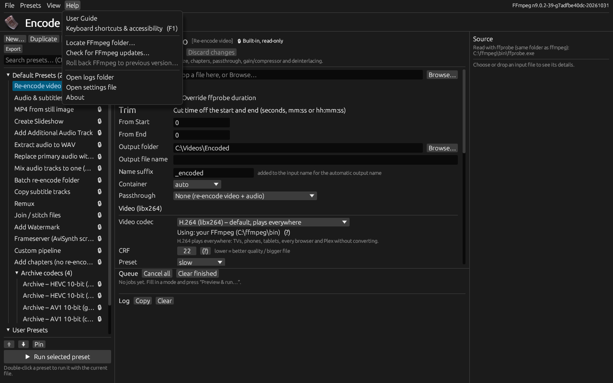

# Encode FFS user guide

Encode FFS is a Windows front end for FFmpeg from PrimeCrew Software. You pick a preset, choose your files, check the exact FFmpeg command, and run the job in a queue.

## Contents

1. [Getting started](getting-started.md): install, find FFmpeg, the main window, your first encode
2. [Single-file presets](single-file-presets.md): Re-encode, Audio & subtitles, Join, still image, watermark and more
3. [Batch re-encode](batch.md): re-encode every video in a folder
4. [Remux](remux.md): change the container without re-encoding
5. [Frameserver](frameserver.md): encode straight from your editor with DebugMode FrameServer and AviSynth+
6. [Create Slideshow](slideshow.md): turn still images into a video
7. [Custom pipeline and custom batches](custom-batch.md): build your own job, for one file or a whole folder
8. [Trim and time formats](trim-and-time.md): cutting the start and end, and how to type times
9. [Presets](presets.md): Default Presets, User Presets, favourites, import and export
10. [Settings](settings.md): folders, FFmpeg, the app-managed copy, GPU encoding, appearance
11. [Job history](history.md): what ran, how long it took and the command that was used
12. [Troubleshooting and FAQ](troubleshooting.md)

## Opening this guide from the app

**Help › User Guide** opens this guide. The installer and the portable zip include a copy in the `docs` folder next to the program, so it works offline. Without that copy, the app opens the online guide on GitHub.

