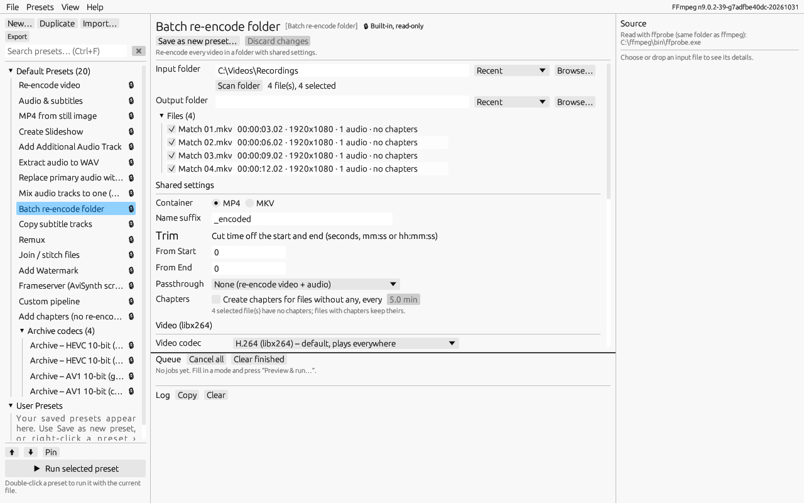

# Batch re-encode

[Back to the guide](README.md)

**Batch re-encode folder** re-encodes every video in a folder with the same settings.

1. Select **Batch re-encode folder**.
2. Drop a folder on the window, type it, pick it from **Recent**, or use **Browse…**. **Scan folder** lists the videos it finds.
3. Untick any file you want to leave out. Each file shows its length, resolution, audio tracks and chapters.
4. Choose an **Output folder**.
5. Set the **Shared settings**: container (MP4 or MKV), name suffix, trim, passthrough, chapters, and the same video and audio options as Re-encode.
6. **Preview & run…** shows one command per file. **Run** queues them all.

Tips:

- **Create chapters for files without any, every N min** adds chapters only to files that have none. Files with chapters keep theirs.
- Each file gets its own progress line in the queue. If one file fails, the others still run.
- Trim applies to every file. See [Trim and time formats](trim-and-time.md).
- The **Recent** list starts with your Settings folder, then folders you used lately.

Want different steps for each file, like copying the video but encoding the audio? Use [Custom pipeline in folder mode](custom-batch.md).

Next: [Remux](remux.md)
