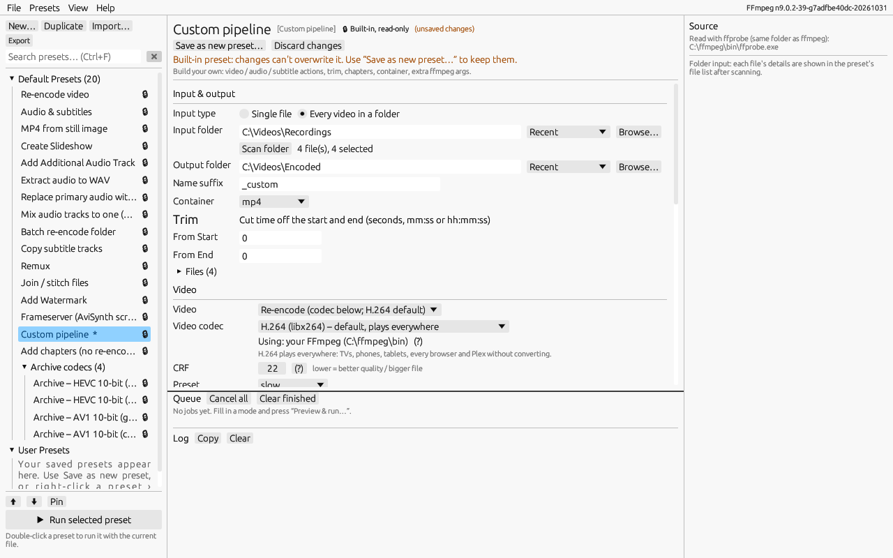

# Custom pipeline and custom batches

[Back to the guide](README.md)

**Custom pipeline** lets you build a job from separate choices for video, audio and subtitles. It works on one file, or on every video in a folder.

## One file or a folder

Under **Input & output**, choose the **Input type**:

- **Single file**: a video or audio file.
- **Every video in a folder**: pick the **Input folder** and **Scan folder**. Open **Files** to tick or untick each file. Choose the **Output folder**; every file uses the same settings.

## The choices

- **Video**: copy, re-encode (H.264 by default, or HEVC / AV1, with CRF, speed, resize, colour range and deinterlacing), or drop.
- **Audio**: copy all, encode all (AAC or AC3), drop, replace with a file, mix all tracks into one, or copy and add a file as an extra track. Bitrate, gain, compressor and a track title are available.
- **Subtitles**: copy, convert text subtitles, drop, or import from a file.
- **Trim**, **chapters** (chapter creator, auto-create when missing, or remove them), **container** (same as input, MP4, MKV, MOV, M4V, M4A or MKA), **name suffix** and **faststart**.
- **Extra input options** and **extra output options** for anything else FFmpeg can do. They go before `-i` and before the output file. Put quotes around values with spaces.

## Matching files in a folder batch

When you replace audio, add an audio track or import subtitles in folder mode, the app uses the file with the same name next to each video. For example `game.mkv` gets `game.wav` or `game.srt`.

## Tips

- Check the command in **Preview & run…** before you run a big batch.
- Save a pipeline you use often as your own preset (**Save as new preset…**). See [Presets](presets.md).
- **Add chapters (no re-encode)** in the Default Presets is a ready-made Custom pipeline.

Next: [Trim and time formats](trim-and-time.md)
