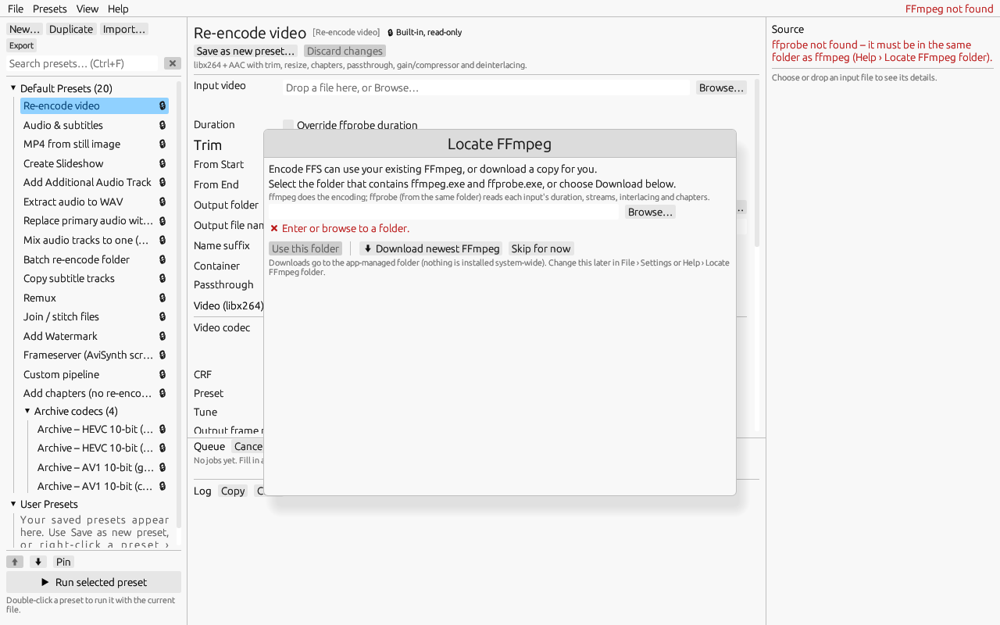
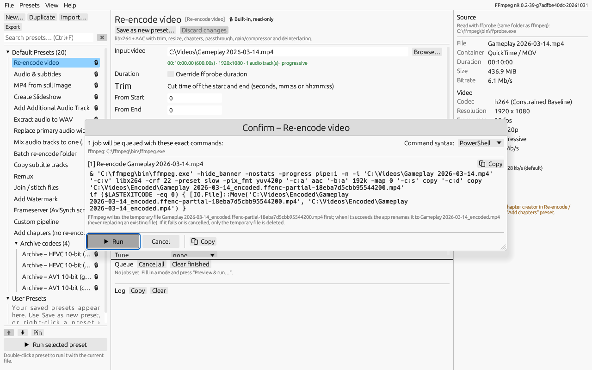

# Getting started

[Back to the guide](README.md)

## What you need

- Windows 10 or 11 (64-bit).
- `ffmpeg.exe` and `ffprobe.exe`. Use a copy you already have (for example `C:\ffmpeg\bin`), or let the app download one for you.

## Install

Choose one:

- **Installer** (`EncodeFFS-v<version>-setup.exe`). "Just for me" is the default and needs no administrator rights. "For everyone" installs to Program Files. You get a Start Menu shortcut under **PrimeCrew Software**, and a desktop shortcut if you want one. An update installs over the existing copy and keeps your settings and presets.
- **Portable zip** (`EncodeFFS-v<version>-win64.zip`). Unzip it anywhere, for example `C:\Apps\EncodeFFS`, and run `Encode FFS.exe`. Settings are kept in `FFmpegEncoder.settings.json` next to the program (or in `%APPDATA%\PrimeCrew Software\Encode FFS` if that folder isn't writable).

## First start: finding FFmpeg

If the app can't find a working FFmpeg, it asks where it is.

- **Browse…** to the folder that holds `ffmpeg.exe` and `ffprobe.exe`, then **Use this folder**. The parent of a `bin` folder works too.
- **Download newest FFmpeg** puts a copy in the app's own folder. Nothing is installed system-wide. See [Settings](settings.md#ffmpeg).
- **Skip for now** closes the dialog. You can come back with **Help › Locate FFmpeg folder…** or **File › Settings…**.

The version of FFmpeg in use is shown at the top right of the window.

## The main window

- **Left: presets.** Default Presets (the ones that come with the app) and User Presets (the ones you save). Click one to select it. See [Presets](presets.md).
- **Middle: the form** for the selected preset: input, output and options.
- **Right: Source.** What ffprobe reports about the input file: container, length, size, video, audio tracks, subtitles and chapters. Turn it on or off in **View › Source info panel**.
- **Bottom: Queue and Log.** Progress for each job, with cancel buttons, and the app's messages.

## Your first encode

1. Select **Re-encode video** in the preset list.
2. Drop a video onto the window, or click **Browse…** next to **Input video**. You can drop files or folders anywhere on the window; the selected preset gets them.
3. Check the **Output folder** and **Output file name**. The name is made from the input name plus the **Name suffix** (`_encoded` by default).
4. Change any options you want. The defaults (H.264, CRF 22, preset slow, AAC 192 kb/s) suit most videos.
5. Press **Preview & run…** (or **F5**, or double-click the preset).
6. The confirmation shows the exact FFmpeg command. Press **Run** to add it to the queue.

**Copy** puts the command on the clipboard for PowerShell or Command Prompt (pick under **Command syntax**), so you can run it yourself.

## While it runs

- The queue shows each job's progress. **Cancel** stops one job; **Cancel all** stops everything.
- FFmpeg writes to a temporary `.ffenc-partial-…` file first. The app renames it to the final name only when FFmpeg succeeds, so a failed or cancelled job never leaves a half-written file under the real name.
- When the jobs finish, an **Encoding Finished** window shows the file, its folder, size and how long it took, with **Go to file** and **Open folder**. You can turn it off in Settings.

## If the output file already exists

Before anything runs, the confirmation lists any file that already exists. For each one choose **Keep both** (the default; the new file gets a name like `name (2).mp4`), **Overwrite** or **Skip this file**. An input file is never overwritten. You can set a fixed choice in [Settings](settings.md).

## Handy keys

| Key | What it does |
|-----|--------------|
| F5 | Run the selected preset |
| Ctrl+O | Open a file or folder for the selected preset |
| Ctrl+N | File › New: start fresh with the selected preset |
| Ctrl+S | Save the preset |
| Ctrl+F | Search presets |
| Ctrl + plus / minus, Ctrl+0 | Text size up, down, back to 100 % |
| F1 | List of keyboard shortcuts |

Tab moves between controls and Esc closes dialogs.

Next: [Single-file presets](single-file-presets.md)
