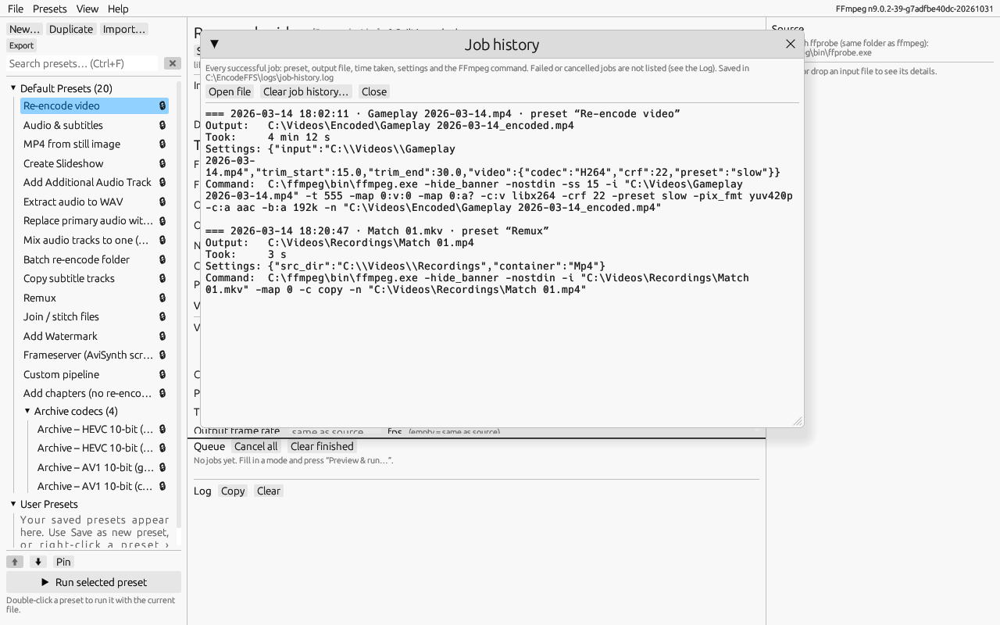

# Job history

[Back to the guide](README.md)

**File › Job history…** lists every job that finished successfully, oldest first.

Each entry shows:

- when it finished, the file and the preset it came from;
- **Output**: the final file name;
- **Took**: how long it ran;
- **Settings**: the form's settings;
- **Command**: the exact FFmpeg command.

In a batch, each successful file gets its own entry. Failed or cancelled jobs are not listed; look in the Log for those.

- **Open file** opens the history file (`logs\job-history.log` next to the settings file).
- **Clear job history…** asks first, then deletes only that file. Your videos, presets, settings and FFmpeg are not touched.

The history is a record to read and copy from. Nothing in it is re-run automatically. To run the same command yourself, copy it from here or from the run confirmation.

Next: [Troubleshooting and FAQ](troubleshooting.md)
