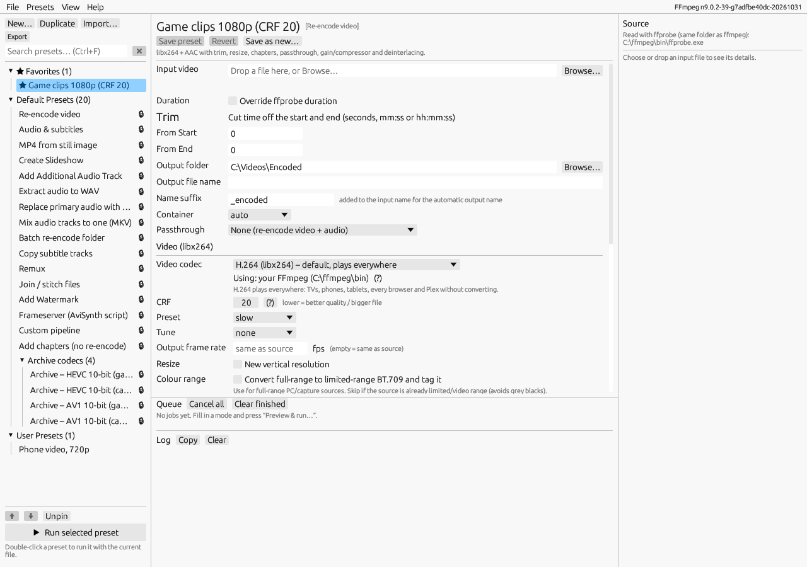

# Presets

[Back to the guide](README.md)

Everything in the list on the left is a **preset**: a named set of options for one kind of job.

## Default Presets and User Presets

- **Default Presets** come with the app (20 of them, including the **Archive codecs** folder). They show a padlock and "Built-in, read-only". An update to the app can refresh them.
- **User Presets** are the ones you make. They are fully yours: save, rename, delete.

## Trying changes on a default preset

You can change any option on a default preset to try something. The preset gets a `*` and a note that changes can't overwrite it.

- **Save as new preset…** (or Ctrl+S) keeps your changes as a new User Preset.
- **Discard changes** puts the defaults back.
- If you pick another preset with unsaved changes, the app asks whether to save them as a new preset, discard them, keep them for later, or cancel.

Default presets can't be renamed or deleted, but you can **hide** one. **Presets › Restore built-in presets…** brings hidden ones back.

## Your own presets

- **New…** starts from a copy of any preset or a blank one of any type.
- **Duplicate** copies the selected preset.
- **Save preset** (Ctrl+S) stores changes, **Revert** drops them, **Save as new…** makes a copy.
- **Pin** puts a preset in **Favorites** at the top of the list. **Set folder…** (right-click) groups presets in folders.
- The arrow buttons move a preset up or down within its group.
- Search the list with the box at the top (Ctrl+F). It matches names, types, folders and descriptions.

Right-click a preset for all of these actions. They are also in the **Presets** menu.

## Running a preset

- Click to select it. Double-click, press **▶ Run selected preset** or **F5** to load the current input and open the confirmation.
- **File › New** (Ctrl+N) starts a fresh job with the selected preset: the options go back to the preset's settings and the file boxes are cleared.

Files you pick (inputs and output names) are not saved in presets. They carry over while the app is open when you switch to another preset that takes a file. When you start the app again, the file boxes are empty and **Browse…** opens in the folder you last used.

## Import and export

- **Import…** reads a presets file (one or many presets). Imported presets get unique names and become User Presets.
- **Export this preset…** or **Export all presets…** saves them to a file you can share or back up. Folder paths are left out.

Next: [Settings](settings.md)
