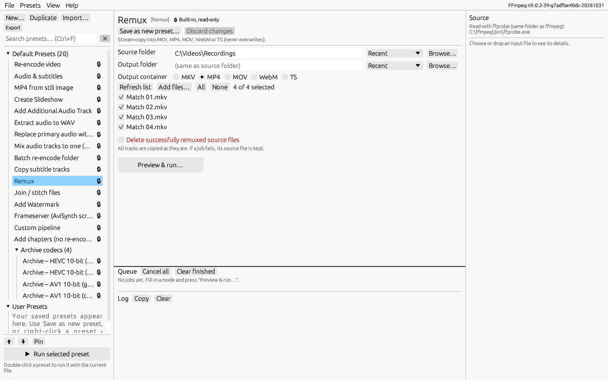

# Remux

[Back to the guide](README.md)

**Remux** moves the video, audio and subtitles into another container (MKV, MP4, MOV, WebM or TS) without re-encoding. It is fast and lossless.

1. Select **Remux**.
2. Pick the **Source folder** (drop it, **Browse…** or **Recent**). The files in it are listed. **Add files…** adds more, and **All** / **None** tick or untick them all.
3. Choose an **Output folder**. Leave it empty to write next to the sources.
4. Choose the **Output container**.
5. **Preview & run…**, then **Run**.

Good to know:

- Remux never overwrites a file. Files that are already in the chosen container are skipped.
- You get a warning when a track can't go into the chosen container, for example some subtitle types in MP4.
- For MP4, FLAC, Opus, Vorbis and PCM audio get a note that many players won't play them.
- **Delete successfully remuxed source files** is off by default. When it's on, a source is deleted only after its new file has been checked. If a job fails, its source is kept.
- Remux can't change the frame rate or quality; use [Re-encode](single-file-presets.md#re-encode-video) for that.

Next: [Frameserver](frameserver.md)
