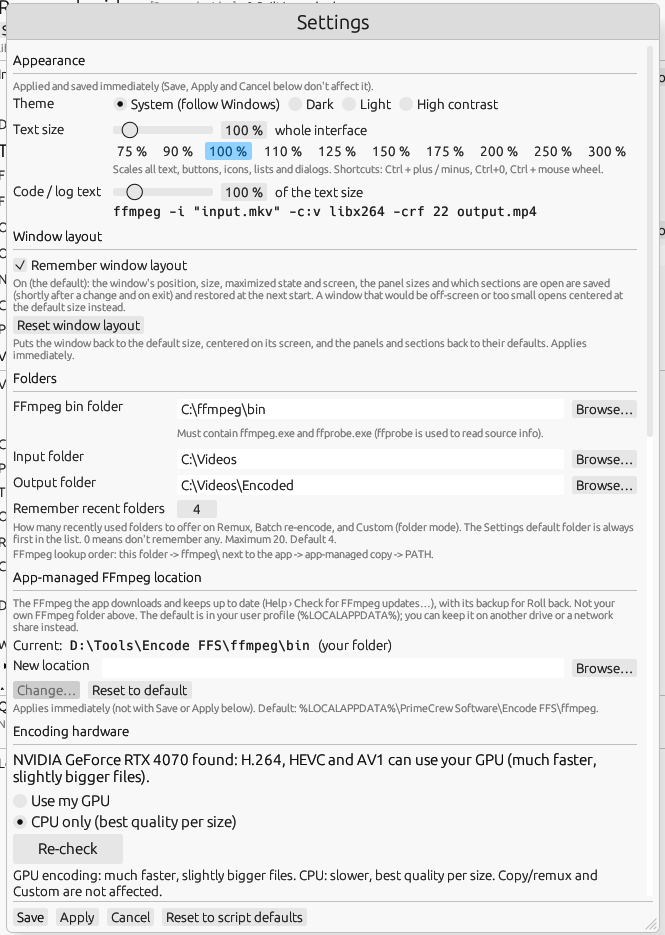
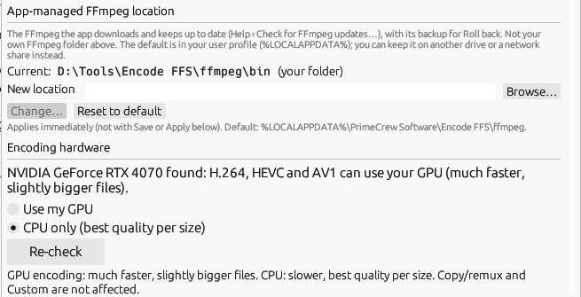

# Settings

[Back to the guide](README.md)

Open **File › Settings…**. **Save** applies and closes, **Apply** applies and keeps the window open, **Cancel** closes without applying. **Reset to script defaults** puts the encoding defaults back.

## Appearance

- **Theme**: System (follows Windows), Dark, Light or High contrast. Also in the **View** menu.
- **Text size**: 75 % to 300 %, for the whole window. Ctrl + plus / minus, Ctrl+0 and Ctrl + mouse wheel work too, as does **View › Text size**. **Code / log text** sets the size of commands and the log on top of that.

Appearance changes apply straight away.

## Window layout

**Remember window layout** (on by default) brings back the window's size and position, the panel sizes and which sections were open. **Reset window layout** goes back to the defaults.

## Folders

- **FFmpeg bin folder**: the folder with `ffmpeg.exe` and `ffprobe.exe`. Leave it empty to let the app look for one.
- **Input folder** and **Output folder**: the defaults used by the forms and by **Browse…**. They start as your Windows Videos folder.
- **Remember recent folders**: how many recent folders the **Recent** lists offer on Remux, Batch re-encode and Custom (folder mode). 4 by default, 0 to turn it off.

## FFmpeg

The app looks for FFmpeg in this order: the **FFmpeg bin folder** above, an `ffmpeg` folder next to the app, the app-managed copy, then your PATH.

### Your own FFmpeg or the app-managed copy

- **Your own FFmpeg**: any folder you choose. The app uses it as it is and **never changes or updates it**.
- **App-managed copy**: a copy the app downloads for you (from the first-start dialog or **Help › Check for FFmpeg updates…**). Updates only ever go into this copy.

### App-managed FFmpeg location

By default the app-managed copy lives in `%LOCALAPPDATA%\PrimeCrew Software\Encode FFS\ffmpeg`. To keep it elsewhere (another drive or a network share), type or **Browse…** to a folder under **New location** and press **Change…**. If a copy is already there, the app offers to move it. **Reset to default** goes back. This applies straight away.

### FFmpeg updates

- **Help › Check for FFmpeg updates…** shows the installed and newest versions and can download a build. Downloads are checked before they are used.
- **Source**: BtbN (default) or gyan.dev. **Channel**: Stable or Latest.
- When you use the app-managed copy, the app checks for a newer build at most once a day and shows a notice. Nothing installs without a click. **Don't automatically check for FFmpeg updates** turns this off.
- **Help › Roll back FFmpeg to previous version…** swaps back to the copy you had before the last update.
- If your own FFmpeg lacks an encoder a job needs (for example AV1) but the app-managed copy has it, that job uses the app-managed copy and the **Using:** line says so.

## Encoding hardware (GPU)

GPU encoding is **off by default**. The app tests your FFmpeg for NVIDIA (NVENC), Intel (Quick Sync) and AMD (AMF) encoders with a short test encode, and shows what it found.

- **Use my GPU**: much faster encodes, slightly bigger files. Every preset that re-encodes H.264, HEVC or AV1 uses the GPU encoder that passed the test. The run preview and the **GPU:** line under **Using:** show it.
- **CPU only (best quality per size)**: the default.
- **Re-check** runs the test again, for example after a driver or FFmpeg update.

If a GPU encode fails, that file is encoded again on the CPU and a batch carries on. Copy, remux and Custom pipeline jobs are never changed.

## Encoding defaults

The values used by default presets you haven't changed and by new blank presets: CRF, preset, audio bitrate, chapter interval, gain and compressor, the name for an added audio track, the fallback sample rate, and the **Length tolerance** for added audio tracks.

## When encoding finishes

**Show Encoding Finished popup** (on by default).

## FFmpeg updates & logs

- **Keep ffmpeg_error\*.log files when a job succeeds**: FFmpeg's detailed log for each job is normally deleted after a successful job and kept when it fails.
- **When the output file exists**: Ask (default), Always keep both, Always overwrite or Always skip. The run confirmation still lists the files.
- **Keep temporary files for debugging**: keeps chapter and list files and unfinished outputs, and writes their paths to the log.

## Where things are stored

- Portable: `FFmpegEncoder.settings.json` and `FFmpegEncoder.presets.json` next to the program.
- Installed (or a portable folder that isn't writable): `%APPDATA%\PrimeCrew Software\Encode FFS`.
- Logs are in the `logs` folder next to the settings file. **Help › Open logs folder** and **Help › Open settings file** take you there.

Next: [Job history](history.md)
