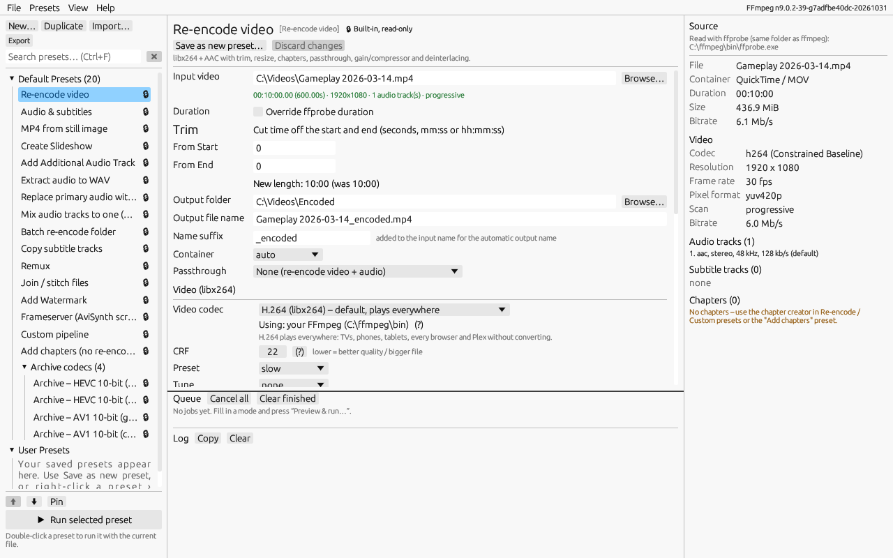
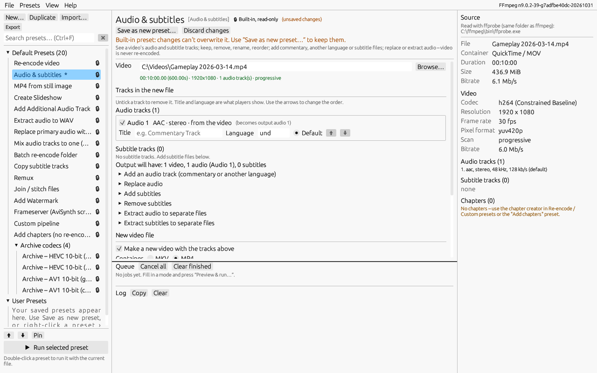

# Single-file presets

[Back to the guide](README.md)

These presets work on one input at a time (Join takes a list). Pick the preset, drop or browse to the file, then **Preview & run…**.

## Re-encode video

The everyday preset: H.264 video and AAC audio by default.

- **Trim**: cut time off the start and end. See [Trim and time formats](trim-and-time.md).
- **Duration**: tick **Override ffprobe duration** if the reported length is wrong.
- **Container**: auto, MP4, MKV or MOV. **Passthrough** copies the video or the audio unchanged instead of re-encoding it.
- **Video codec**: H.264 (default, plays everywhere), HEVC / H.265 or AV1. The **Using:** line shows which FFmpeg does the encode. A codec your FFmpeg doesn't have is marked "(not in your FFmpeg)"; pick it and a button offers to use the app's own FFmpeg for it.
- **CRF** sets quality: lower is better quality and a bigger file. The **(?)** next to it explains the scale and suggests a range for your video. CRF numbers are not the same across codecs.
- **Preset** (encoder speed) and **Tune**.
- **Output frame rate**: leave it empty to keep the source rate, or type one (for example `30`, `29.97` or `30000/1001`). FFmpeg drops or repeats frames, so the length and audio sync stay the same.
- **Resize** (keeps the shape), **Colour range** (full to limited range for PC/capture sources), deinterlacing, **Crop** and **Add watermark**.
- **Audio**: AAC (default), AC3 or keep the original; bitrate, gain and compressor.
- **Chapters**: keep the source's, create one every N minutes, or make your own list with the **Chapter creator…**.

All audio and subtitle tracks are kept where the container allows.

### Archive codecs

The **Archive codecs** folder holds four ready-made Re-encode presets for long-term storage: HEVC 10-bit and AV1 10-bit, each for game footage or camera footage.

## Audio & subtitles

Everything about a video's sound and subtitle tracks. The picture is never re-encoded.

- **Tracks in the new file**: untick a track to remove it, edit its title and language, choose the default track, and move tracks with the arrows.
- **Add an audio track**: a commentary or second language, from an audio file or another video. Set volume, delay (if it's out of sync) and an optional mixed "main + new" track.
- **Replace audio**, **Add subtitles** (.srt, .ass, .ssa, .vtt, .sub, .sup), **Remove subtitles**.
- **Extract audio** to WAV, FLAC, MP3, AAC, Opus or the original format, and **extract subtitles** to .srt or .ass.
- **Output will have: …** sums up what the new file will contain.
- MKV takes every kind of audio and subtitle. MP4 plays everywhere but only takes some audio formats and text subtitles; the app converts or leaves things out and tells you.

An added track that is a little longer or shorter than the video is fine. Beyond the **Length tolerance** in Settings (1.5 s by default) you get a warning, but the job still runs.

## Join / stitch files

Joins several videos into one, top to bottom.

- Add files by dropping them, **Add files…** or **Add folder…**. Reorder by dragging or with the arrows, or sort by name or date.
- **Fast, lossless** (default) copies the streams. It needs files with the same format; if they differ, a warning explains how and offers **Switch to re-encode join**.
- **Re-encode** scales every file to the first one's size and frame rate, so mixed sources work.
- **One chapter per source file** is on by default, named after each file.

## Other single-file presets

| Preset | What it does |
|--------|--------------|
| MP4 from still image | One image plus an audio file becomes a video. Length follows the audio or a fixed time. |
| Add Additional Audio Track | Copies the video and its audio and adds an audio file as a new track. |
| Extract audio to WAV | Saves an audio track as WAV. With several tracks you choose one, or each to its own file. |
| Replace primary audio with WAV | Copies the video and replaces its audio with a WAV file. |
| Mix audio tracks to one (MKV) | Mixes two or more audio tracks into one. The video is copied. |
| Copy subtitle tracks | Adds chosen subtitle tracks from a second file. |
| Add Watermark | Places an image on the video. Drag it into place, resize it and set the opacity. Works on files, a folder or dropped files. |
| Add chapters (no re-encode) | Copies everything and adds chapters every 5 minutes (or your own list). |

Next: [Batch re-encode](batch.md)
