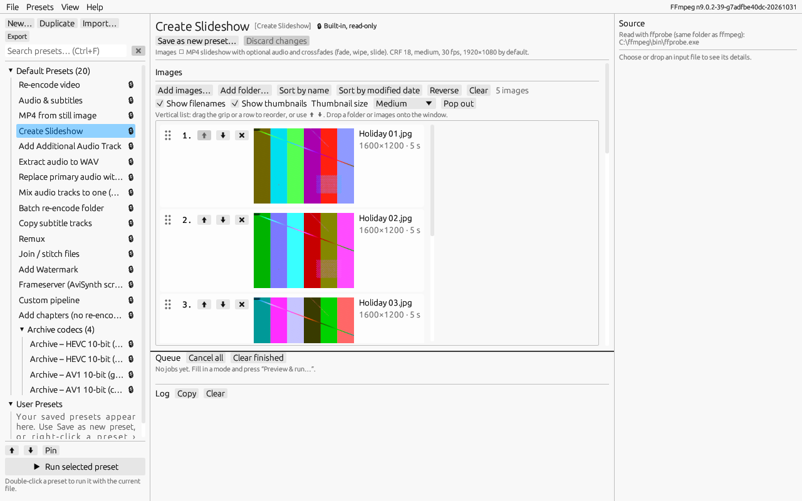

# Create Slideshow

[Back to the guide](README.md)

**Create Slideshow** turns still images into an MP4 video, with optional music and transitions.

## Images

- Add images with **Add images…**, **Add folder…**, or by dropping them on the window. JPG, PNG, BMP, WebP and TIFF work.
- Change the order by dragging the grip or a row, or with the arrow buttons. **Sort by name**, **Sort by modified date** and **Reverse** reorder the whole list. **Clear** empties it.
- Show or hide file names and thumbnails, and pick a thumbnail size. **Pop out** opens the list in its own window.

## Timing

- **Per image length** (5 seconds by default), a **Fixed total length**, or **Match audio length** (needs an audio file).
- Times accept seconds or mm:ss. See [Trim and time formats](trim-and-time.md).
- **Transitions**: None (hard cut), Fade, Fade through black or white, Dissolve, Wipe or Slide left or right. Each image is fully visible for its own time, and each transition adds its time on top. For example, 3 images of 5 s with 2 s fades make 3×5 + 2×2 = 19 s.

## Picture and encode

- **Size**: 1920×1080 by default, or Auto and other common sizes. Images keep their shape, with black bars where needed. Smaller images get a black border, or you can scale them up.
- H.264, CRF 18, 30 fps, MP4 by default. HEVC, AV1 and AC3 are offered too.
- Add an audio file for music; it is encoded as AAC by default.

**Preview & run…** shows the command, then **Run**.

Next: [Custom pipeline and custom batches](custom-batch.md)
