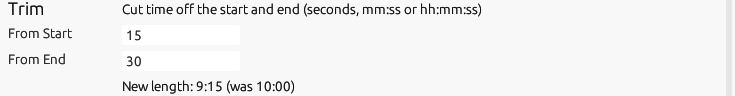
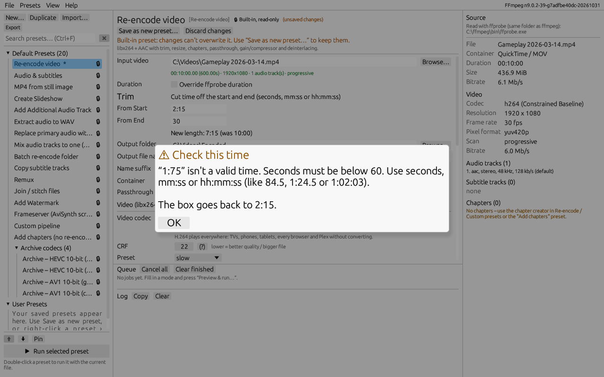

# Trim and time formats

[Back to the guide](README.md)

## Trim

Re-encode, Batch re-encode and Custom pipeline have a **Trim** section.



- **From Start**: how much to cut off the beginning.
- **From End**: how much to cut off the end. This is an amount to remove, not an end time. To keep a 10-minute video up to 9:30, enter `30`.
- Leave both at `0` to keep the whole video.
- In Re-encode, where the length of the source is known, **New length** shows the result, for example "New length: 9:15 (was 10:00)".

The [Frameserver](frameserver.md) preset trims in frames instead.

## Typing times

Every box that takes a time (trim, the duration override, the still image length, slideshow times and the Settings defaults) accepts:

| You type | It means |
|----------|----------|
| `84.5` | 84.5 seconds |
| `90` | 90 seconds (a whole number on its own is seconds) |
| `12:30` | 12 minutes 30 seconds (mm:ss) |
| `1:05.5` | 1 minute 5.5 seconds |
| `1:02:03` | 1 hour 2 minutes 3 seconds (hh:mm:ss) |
| `1:02:03.25` | the same plus a quarter second |

FFmpeg always gets plain seconds.

## When a time isn't valid

If an entry can't be read (letters, a negative number, minutes or seconds of 60 or more in the colon forms, too many colons), a message pops up when you leave the box or press Enter. The box goes back to its last good value. A trim that would remove the whole video gets the same message.



## Chapter times

The chapter creator's **set from timestamp** and **import from text** accept the same forms, plus `1h2m3s`. One chapter per line, for example:

```
00:00:00 Intro
00:12:30 Boss fight
1:02:03.250 - Credits
```

Chapter times count from the start of the trimmed output.

Next: [Presets](presets.md)
